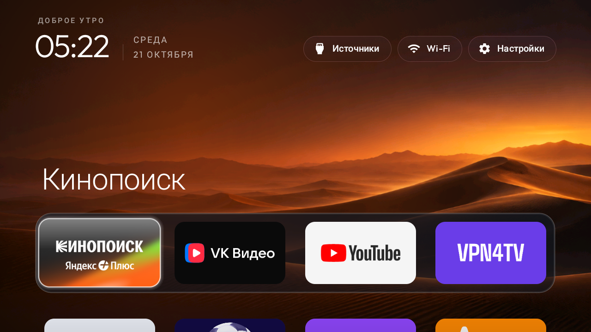
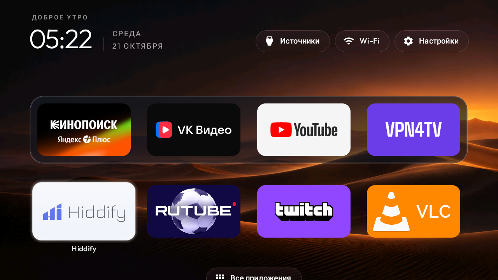
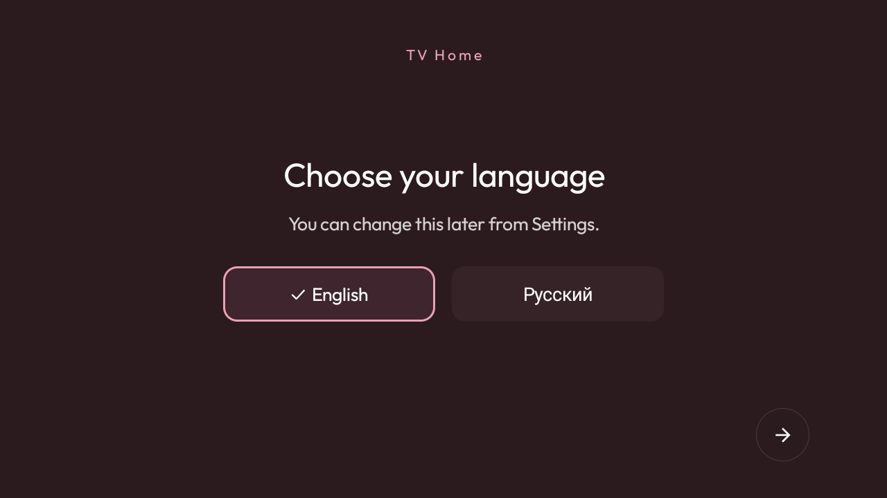
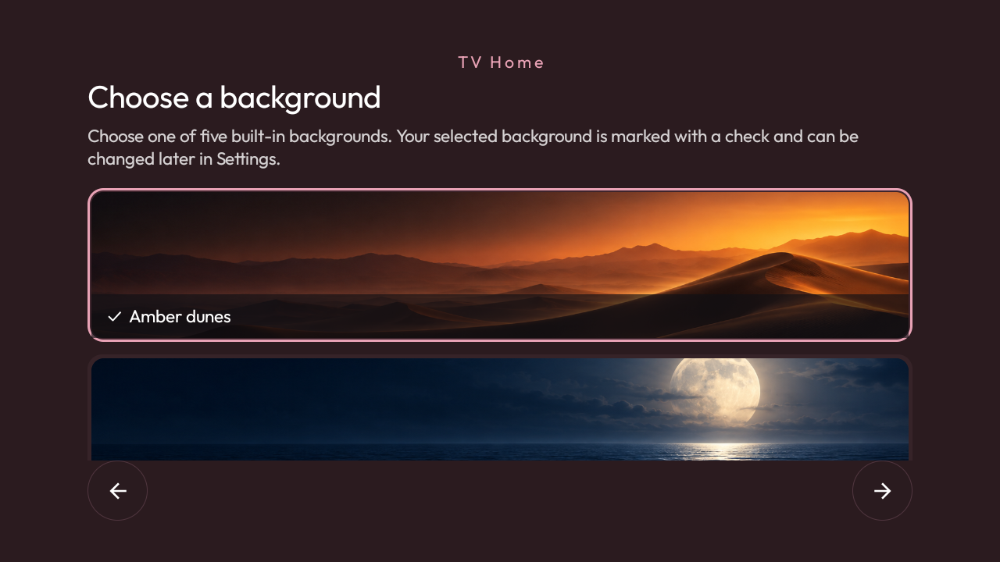

# TV Home

[](CHANGELOG.md)
[](docs/INSTALL.md)
[](.github/workflows/ci.yml)
[](LICENSE)

TV Home is a calm, ad-free launcher for Android TV and Google TV. It puts four favourite apps in a glass dock, keeps the apps you choose on Home, and leaves everything else one click away in **All apps**.



The APK is universal: it contains no personal package names, preselected streaming services, device identifiers, accounts, or hidden-app lists. First-run setup discovers the launchable apps already installed on the TV and lets each user build their own Home screen.

## Highlights

- Remote-first navigation with predictable D-pad focus.
- English and Russian first-run setup.
- A four-app glass dock and a separate Home-app list.
- Five built-in 16:9 backgrounds, selectable during setup or later in Settings.
- **All apps** catalogue for everything not pinned to Home.
- Inputs, network status, system Settings, app reordering, and a clock screensaver.
- No ads, analytics, accounts, content feeds, or `INTERNET` permission.
- Works offline after installation.

## Screenshots

| Home | All apps |
| --- | --- |
|  |  |

| Language setup | Background setup |
| --- | --- |
|  |  |

The Home screenshots are captures from a test television and show one example configuration. Third-party app names and trademarks belong to their respective owners; TV Home does not bundle or recommend those apps.

## Compatibility

- Android TV or Google TV running Android 8.0 / API 26 or newer.
- A television or streaming device that allows third-party Home apps.
- A standard TV remote with a directional pad and OK/Back/Home buttons.

Samsung Tizen, LG webOS, Roku, and Apple TV cannot install Android APKs. Some Android TV manufacturers also lock the default launcher; on those devices TV Home can still be opened as an app, but the Home button may continue to open the stock launcher.

## Install

1. Download `TV-Home-v1.0.0.apk` and its `.sha256` file from the [latest GitHub Release](../../releases/latest).
2. Enable developer options and ADB debugging on the TV.
3. Install the APK:

   ```text
   adb connect TV_IP_ADDRESS:5555
   adb install -r TV-Home-v1.0.0.apk
   ```

4. Open TV Home and complete language, dock, Home-app, and background setup.
5. Press Home, choose **TV Home**, and select **Always**. If no chooser appears, use the TV's **Settings → Apps → Default apps → Home app** page.
6. Turn ADB debugging off when installation is complete.

The complete guide, including ADB fallback commands and instructions for returning to the original launcher, is in [docs/INSTALL.md](docs/INSTALL.md).

## Privacy

TV Home does not transmit or collect data. App choices, language, layout, and wallpaper settings stay on the television. Network-state access is used only to display the current Wi-Fi/Ethernet/VPN status. See [docs/PRIVACY.md](docs/PRIVACY.md).

## Build from source

Requirements: JDK 17, Android SDK Platform 34, and Android Build Tools 34.0.0.

```powershell
$env:ANDROID_HOME = "$env:LOCALAPPDATA\Android\Sdk"
cd launcher
.\gradlew.bat --no-daemon testReleaseUnitTest lintRelease assembleRelease
```

The APK is written to `launcher/app/build/outputs/apk/release/app-release.apk`. Local builds use the Android debug key for convenient testing; public releases must use the permanent release key described in [docs/RELEASING.md](docs/RELEASING.md).

## Release and contribution files

- [Installation guide](docs/INSTALL.md)
- [Troubleshooting](docs/TROUBLESHOOTING.md)
- [Privacy statement](docs/PRIVACY.md)
- [Release procedure](docs/RELEASING.md)
- [GitHub publishing checklist](docs/GITHUB_PUBLISHING.md)
- [v1.0.0 release notes](docs/releases/v1.0.0.md)
- [Changelog](CHANGELOG.md)
- [Contributing](CONTRIBUTING.md)
- [Security policy](SECURITY.md)
- [Support](SUPPORT.md)

## License and credits

TV Home is released under the [MIT License](LICENSE). It builds on the launcher component of [CleanYourTV](https://github.com/Gathin23/cleanyourtv); attribution and third-party license details are listed in [NOTICE](NOTICE). The Outfit typeface is licensed under the SIL Open Font License 1.1.
